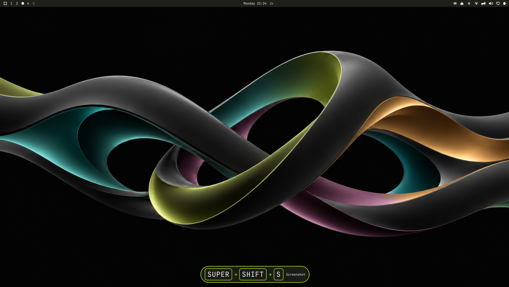

# Chordlight

*A little light for every shortcut.*

Chordlight is a local-first guide for your registered Omarchy keyboard
shortcuts. Hold a configured modifier to see a small outlined hint for matching
shortcuts at a configurable position on the focused monitor, without changing
how they work.



*The hint appears only when a held modifier matches a registered shortcut.*

## Requirements

Chordlight is tested with Omarchy 4.0.1, Quickshell 0.3.1, and Hyprland 0.56.2.
It is designed for Omarchy's Lua-based Hyprland configuration.

## Install

Install the fork directly from GitHub:

```sh
omarchy plugin add https://github.com/zaremb/chordlight.git --enable
```

Open the Chordlight bar widget and select **Enable visual keybinding guide**.
Before anything changes, Chordlight shows the exact three-line bridge it
proposes to add to the resolved Hyprland configuration. The button is the only
action that writes configuration.

The controller preserves safe symlinks and user-owned Git-dotfiles targets. If
the target cannot be verified, Chordlight stays in setup mode and offers a
manual snippet instead; it never asks for root access or modifies an unsafe
target.

## Using the guide

Hold `SUPER`, `SHIFT`, `CTRL`, or `ALT` to open a guide for shortcuts beginning
with that key. After the configured delay, Chordlight shows the held modifier
when it prefixes a registered shortcut. While a matching shortcut key is held,
the bottom hint shows its complete chord, such as `SUPER + SPACE`. After
release, the chord and its registered description remain in a short visual
history for up to 3 seconds. The guide shows the selected number of completed
chords alongside the current chord or matching modifier prefix, with each
history entry expiring independently. By default it keeps two completed chords,
with the current chord anchored at the selected screen edge. **Normal** keeps
history extending inward from that edge; **Inverted** places the current chord
at the far side of the stack and lets history extend toward the edge. Unmatched
keys are not shown.

The panel preview reflects the live guide and lets you choose its screen
position, description placement, pill size, stack spacing, history count,
stack direction, history duration, and how strongly older chords fade. A
duration change applies to chords completed afterward; chords already in
history keep their current countdown. Setting history to **Off** clears
completed chords while leaving a held chord visible.

## Settings file

Chordlight stores preferences in:

```text
${XDG_CONFIG_HOME:-$HOME/.config}/omarchy/chordlight.toml
```

The panel controls are saved there and update the guide immediately. The file
also holds advanced settings that are not shown in the panel: guide delay,
which modifier keys open the guide, fullscreen behavior, and debug tracing.
Edit those values directly in the TOML file; Chordlight watches it and applies
valid changes as they are saved. On first launch, existing guide and debug
preferences from the old Omarchy shell configuration are imported once.

The file contains these sections:

```toml
schema_version = 1

[display]
position = "bottom-center"          # top-left, top-center, top-right, bottom-left, bottom-center, bottom-right
description_mode = "inline"         # inline, below, hidden
pill_size = "medium"                # small, medium, large
stack_gap = "default"               # tight, default, loose
history_count = 2                   # 0, 1, or 2
stack_direction = "normal"         # normal, inverted
history_duration_seconds = 3        # 1, 2, 3, 5, or 10
history_transparency = "balanced"  # faded, balanced, clear

[guide]
delay_ms = 0                        # -1 disables the guide; otherwise 0, 80, 150, or 250
show_in_fullscreen = false

[guide.keys]
super = true
shift = true
ctrl = true
alt = true

[debug]
trace_enabled = false
```

Invalid settings leave the guide at its last valid values and are reported in
the panel. Unknown TOML keys are ignored so future versions can add settings
without breaking older installations.

## Privacy and local files

By default, Chordlight does not persist shortcut events. The guide keeps only
a brief, in-memory visual chord history so released shortcuts can remain on
screen for up to 3 seconds. Chordlight has no network client and does not use
`/dev/input`.

When `debug.trace_enabled` is set to `true` in the settings file, Chordlight
records timestamps, matched registered shortcut chords, and guide state before
and after each transition.
It does not record typed text, unmatched keys, descriptions, dispatcher
arguments, or window details. The trace stays on this machine, is limited to
512 KB per file with two rotated copies, and uses private file permissions.
Each JSONL line is one event: matched chords have a press/release phase, while
guide transitions include their cause and state snapshots with phase, root,
modifier mask, pending chords, and history sequence/deadline data. Set it to
`false` to stop recording.

Its fresh, independent runtime state lives here:

```text
${XDG_STATE_HOME:-$HOME/.local/state}/omarchy/chordlight/
├── catalog.json            # registered shortcut descriptions and opaque IDs
├── bridge-catalog.lua      # allowlist used by the in-memory Hyprland bridge
├── bridge-control.lock     # prevents concurrent configuration changes
├── debug/                  # created only when Debug trace is enabled
│   ├── trace.jsonl         # local transition trace, with bounded rotations
│   ├── trace.1.jsonl       # older rotated trace
│   └── trace.2.jsonl       # oldest retained trace
└── backups/                # rollback copies created only when config changes
```

Chordlight does not read, import, or delete Omakeez state. See the detailed
[security and privacy guide](docs/SECURITY.md), including an explanation of the
[auditable bridge](bridge.lua).

## Update, disable, or remove

Chordlight is a separate plugin from Omakeez, with its own ID and GitHub
repository. Update it by its Chordlight ID:

```sh
omarchy plugin update io.github.zaremb.chordlight --yes
```

To disable or remove Chordlight, first open its panel and select
**Disable visual guide** to remove only its managed Hyprland bridge block, then
run:

```sh
omarchy plugin disable io.github.zaremb.chordlight
omarchy plugin remove io.github.zaremb.chordlight --yes
```

### Switching from Omakeez

Chordlight does not replace, update, or migrate the Omakeez marketplace plugin.
Before installing this fork, open the old Omakeez panel and select
**Disable visual guide** so its own controller removes its Hyprland bridge.
Then remove the old plugin and install Chordlight directly:

```sh
omarchy plugin disable io.github.cyprusad.omakeez
omarchy plugin remove io.github.cyprusad.omakeez --yes
omarchy plugin add https://github.com/zaremb/chordlight.git --enable
```

Chordlight starts with a clean state directory and leaves Omakeez's old state
untouched. Review its rollback backups before deciding whether to remove that
old directory.

## Limitations

The guide identifies configured binding candidates from Hyprland's input event
and binding table. It does not claim to prove that a later dispatcher command
completed successfully. App-owned credential prompts such as 1Password are
outside Omarchy's lock/Polkit suppression boundary, but typed content is never
stored or emitted.

For recovery steps and every controller safety code, see
[Troubleshooting](docs/TROUBLESHOOTING.md).
